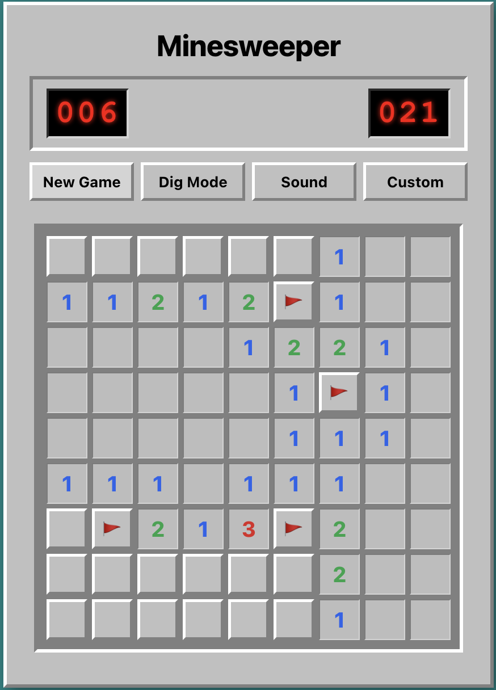

# Minesweeper

This is a simple implementation of the classic game Minesweeper.



## Table of Contents
- [Introduction](#introduction)
- [Features](#features)
- [How to Play](#how-to-play)
- [Installation](#installation)
- [Usage](#usage)

## Introduction

Minesweeper is a popular puzzle game where the player's objective is to clear a rectangular board containing hidden mines without detonating any of them. The game is won when all non-mine cells are revealed.

This project aims to provide a fun and interactive Minesweeper game that can be played on your computer.

## Features

- Customizable board size and mine count
- Interactive gameplay with left-click to reveal cells and right-click to flag potential mines
- Timer to track your progress
- High score tracking

## How to Play

- Left-click or tap in Dig Mode to reveal a tile
- Right-click or tap in Flag Mode to flag/unflag a suspected mine
- Click a revealed number to chord and reveal adjacent tiles when flags match
- Start a fresh game at any time with New Game

## Installation

1. Clone the repository:

   ```bash
   git clone https://github.com/sindhupr11/minesweeper.git
   ```

2. Navigate to the project directory:

   ```bash
   cd minesweeper
   ```

3. Install dependencies:

   ```bash
   npm install
   ```

## Usage

Start the development server:

```bash
npm start
```

Runs the app in development mode at [http://localhost:3000](http://localhost:3000).
